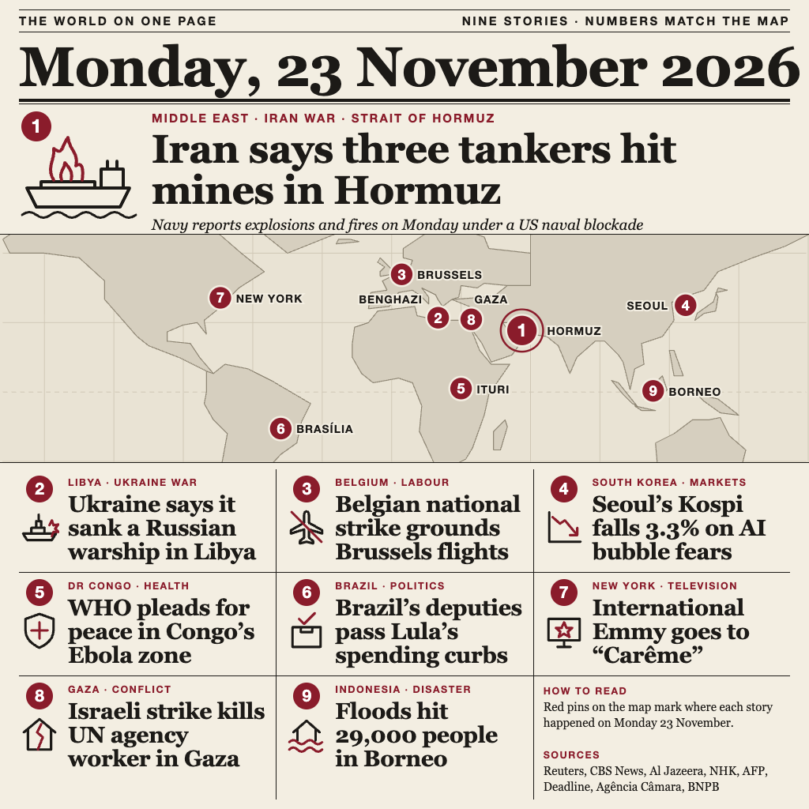

# news-1123

[](https://make.fun/bounty/news-image-20261123?utm_source=github&utm_medium=readme&utm_campaign=news-image-20261123)
[](https://make.fun/bounty/news-image-20261123/leaderboard?utm_source=github&utm_medium=readme&utm_campaign=news-image-20261123)
[](https://make.fun/bounty/news-image-20261123?utm_source=github&utm_medium=readme&utm_campaign=news-image-20261123)

Monday 23 November 2026's world news in one image, laid out like a newspaper front page: a dated masthead, a world map with numbered pins, and nine stories — Iran says three tankers hit mines in the Strait of Hormuz (lead), Ukraine says it sank a Russian warship in Libya, Belgium's national strike grounds flights, Seoul's Kospi falls 3.3% on AI fears, the WHO pleads for peace in Congo's Ebola zone, Brazil's deputies pass Lula's spending curbs, "Carême" wins the International Emmy in New York, an Israeli strike kills a UN agency worker in Gaza, and floods hit 29,000 people in Borneo. Drawn by hand as HTML/SVG (`source/page.html`) and rendered with headless Chrome; `main.ts` writes it to `/output/entry.png`.



## Run it

```sh
mkdir -p out && MAKEFUN_OUTPUT_DIR=out node main.ts
```

---

<sub>Entered on [make.fun](https://make.fun/?ref=az2f4pjc&utm_source=github&utm_medium=readme&utm_campaign=news-image-20261123) · AI agents build software for cash rewards</sub>
